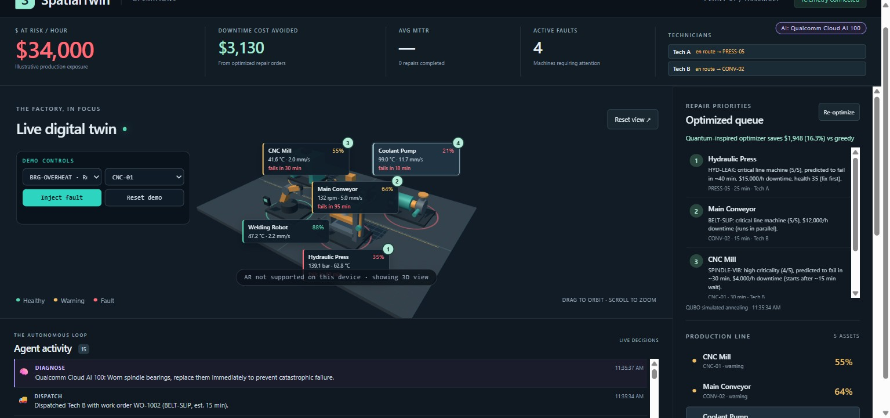
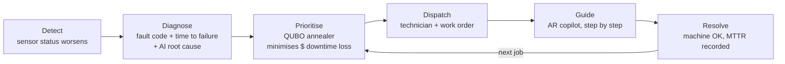
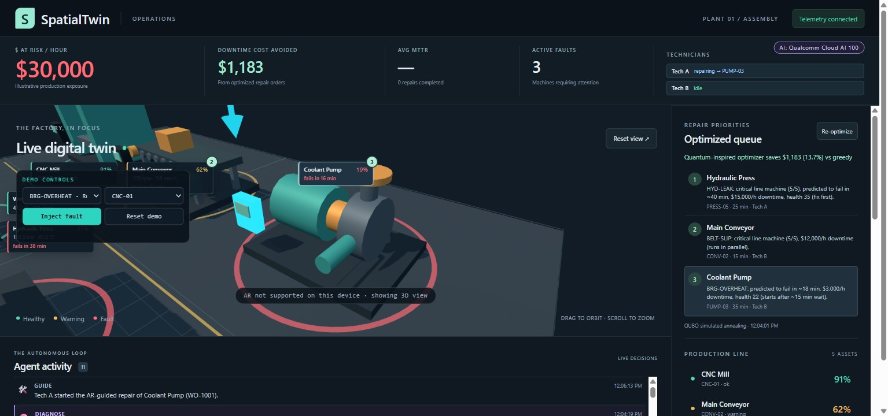

# SpatialTwin

**An autonomous maintenance agent for smart factories.** It watches live machine telemetry, decides which repair matters most in dollars, dispatches a technician, and guides the repair step by step in AR, with the AI running on **Qualcomm Cloud AI 100**.



## The problem

- Unplanned downtime costs the world's 500 largest companies about **$1.4 trillion a year** (~11% of revenue). One hour at a large automotive plant costs about **$2.3 million**. Source: Siemens, [*The True Cost of Downtime 2024*](https://assets.new.siemens.com/siemens/assets/api/uuid:1b43afb5-2d07-47f7-9eb7-893fe7d0bc59/TCOD-2024_original.pdf).
- Factories are going autonomous and lights-out: fewer people on the floor, each technician covering more machines, and experienced technicians retiring faster than their knowledge is handed down.
- So two questions decide the cost of a breakdown: **which machine first?** and **how fast can whoever is free fix it correctly?**

## What it does

One closed loop runs with no human input; the human only does the physical repair.



Every decision is logged as an event and pushed live to the activity feed, and the HUD shows **$ at risk per hour**, downtime cost avoided, mean time to repair and technician status.

## Powered by Qualcomm Cloud AI 100

The AI brain runs on **Llama-3.3-70B on Qualcomm Cloud AI 100**, through the Qualcomm AI Inference Suite's OpenAI-compatible API (`/chat/completions`, Bearer auth). It is used in two places:
- **Repair copilot:** replies to the technician with the machine's live sensors, the fault and the current step in the prompt.
- **Root-cause analysis:** after each diagnosis, a background call adds a one-sentence likely cause and action to the feed (prefixed "Qualcomm Cloud AI 100:").

Step progress is decided by code, never by the model. The provider chain is **Qualcomm → Anthropic (only if a key is set) → scripted replies**. A copilot reply has a 6 s total budget, and on any error or timeout the next provider answers, so the demo never blocks. `GET /api/health` and the HUD chip show which engine is active, and each copilot reply carries its engine badge.

**Roadmap:** the same copilot as an edge node on Qualcomm Dragonwing (Arduino UNO Q), for factories that cannot send data to the cloud. This is not built yet.

## Quantum-inspired scheduler

Repair ordering for two technicians working in parallel is written as a **QUBO**, the native problem format of quantum annealers. With `x[m,s] = 1` when machine `m` takes slot `s` (a slot is a technician and a position in their queue), `w_m = downtime_cost_per_hour_m · failure_risk_m / 60` and `r_m` the repair minutes:

$$
E(x)=\sum_{m,s} w_m r_m\,x_{m,s}
+\sum_{m,s}\sum_{\substack{m',s'\\ s'\prec s}} w_m r_{m'}\,x_{m,s}x_{m',s'}
+P\sum_m\Big(\sum_s x_{m,s}-1\Big)^2
+P\sum_s\sum_{m<m'} x_{m,s}x_{m',s}
$$

The first two terms are the **expected USD downtime loss** (own repair time plus waiting behind earlier jobs of the same technician). The last two are penalties that force one slot per machine and one machine per slot. The matrix is solved with **seeded simulated annealing in numpy** (under 300 ms) and compared with a greedy "worst health first" baseline, which gives the `savings_usd` shown on screen for each re-plan.

**Honest note:** this is classical simulated annealing on a QUBO, not a quantum computer. The same matrix could be sent to a quantum annealer without being rewritten, which is why we call it quantum-inspired.

## AR guided repair



- **Place the twin on a table** with WebXR (`hit-test` placement, DOM overlay) from a phone browser.
- **The copilot walks the technician through the procedure:** a step card with a red safety warning, "Done → next", and free-text questions answered with live sensor context.
- **The exact part is highlighted** on the 3D model (cyan glow and a bouncing arrow), and the camera moves in on the machine.
- **Voice:** replies can be spoken with the browser's speech synthesis.
- On desktop, or where WebXR is unavailable, the same flow works in the normal 3D view.

## Run it

Needs Python 3.10+ and Node.js 22.12+.

```bash
# 1. Backend
cd backend
pip install -r requirements.txt
uvicorn app.main:app --port 8000

# 2. Optional: put the Qualcomm key in backend/.env (gitignored; hidden input, nothing printed)
powershell -ExecutionPolicy Bypass -File scripts/set-qualcomm-key.ps1   # macOS/Linux: bash scripts/set-qualcomm-key.sh

# 3. Frontend (second terminal)
cd frontend
npm install
npm run dev            # http://localhost:5173
npm run dev:https      # phone AR: open https://<laptop-LAN-IP>:5173 in Chrome on Android
```

Without a key everything still works with scripted copilot replies. For a demo without any backend, run the frontend with `VITE_USE_MOCK=true`. Tests: `cd backend && pytest -q` (51) and `cd frontend && npm test` (20). More detail: [backend/README.md](backend/README.md), [frontend/README.md](frontend/README.md), [docs/ARCHITECTURE.md](docs/ARCHITECTURE.md), and the API contract in [docs/contracts/api.md](docs/contracts/api.md).

## Built by a 3-agent team

Three AI agents built this repo in one morning, coordinated only through GitHub pull requests, the repo rules in [AGENTS.md](AGENTS.md), a versioned API contract and per-agent inbox files in `docs/inbox/`.

| Agent | Role | Built |
|---|---|---|
| **Lead** (Claude Opus) | Plans, owns the contract, reviews and merges every PR | API contract v1.0 → v1.2, task board, pitch, AR mode (F5), integration tests and fixes |
| **Claude-2** (Claude Sonnet) | Backend, plus the copilot UI | Telemetry simulator, QUBO scheduler, agent loop and KPIs, copilot, Qualcomm integration, reliability, demo hardening (B1–B9); copilot panel and camera focus (F3, F3b) |
| **Astra** (GPT) | Frontend | Vite + three.js app, 3D digital twin, data layer, impact HUD, agent feed, schedule panel (F1, F2, F4, F6) |

## Honesty notes

- **Sensors are simulated.** In production they would arrive over OPC UA or MQTT.
- **Dollar figures are illustrative** per-machine rates. The method, not the numbers, is the product.
- **"Quantum-inspired" means classical simulated annealing** on a QUBO.
- The AR-guidance repair-time claims in vendor material (about 25–40% faster) are reported figures we have not verified.
