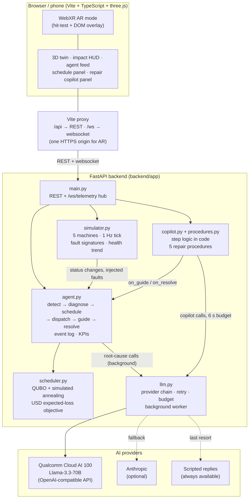

# Architecture

SpatialTwin is a browser app plus a FastAPI backend. The browser (or a phone in AR) talks to one origin: the Vite dev server proxies `/api` and `/ws` to the backend, so WebXR works over a single HTTPS origin. The wire format is defined in [contracts/api.md](contracts/api.md).

## Modules

**Frontend (`frontend/src`).** A Vite + TypeScript app with three.js and no UI framework. `api.ts` is the data layer: it loads a REST snapshot, then follows `/ws/telemetry` (machines, KPIs, and `event` frames) with automatic reconnect, or reads `shared/mock/` fixtures when `VITE_USE_MOCK=true`. `scene.ts` and `models.ts` build the low-poly factory with named child meshes per part, status rings and floating labels; `highlight.ts` makes the current repair part glow, and `camera-focus.ts` moves the camera in on a machine during a repair. `impact.ts` renders the HUD and the activity feed, `copilot.ts` renders the guided-repair panel, and `xr.ts` adds WebXR placement.

**API and websocket hub (`backend/app/main.py`).** Exposes the REST endpoints and `/ws/telemetry`. A 1 Hz loop ticks the simulator, passes status changes to the agent, and broadcasts a `telemetry` message (machines plus KPIs). Agent events are pushed to connected clients the moment they happen as `event` messages. It also serves the demo endpoints for injecting a fault and resetting the scenario.

**Simulator (`simulator.py`).** Holds the five machines in the exact starting state of `shared/mock/machines.json`. Each tick jitters the sensors and, for faulted machines, drifts them worse and lowers health (floor 5). Status follows health (≥75 ok, ≥45 warning, else fault). `predicted_failure_min` comes from the health slope over the last ~30 s. Injecting one of the five fault codes jumps the sensors to that fault's signature immediately.

**Agent loop (`agent.py`).** The autonomous loop. A worsening status or an injected fault produces a `detect` and a `diagnose` event, re-runs the scheduler (`schedule` event), and dispatches idle technicians with work orders (`dispatch`). The copilot calls back when a technician starts (`guide`) and finishes (`resolve`), which records MTTR and dispatches the next job. It keeps the event log and computes the KPIs (dollars at risk, cost avoided, MTTR, technician status). After each diagnosis it queues an AI root-cause call on a background worker.

**Scheduler (`scheduler.py`).** Builds a QUBO over machine × technician-slot binary variables whose energy is the expected USD downtime loss for two technicians in parallel, plus penalty terms that keep the assignment valid. It solves it with seeded simulated annealing (flip, reassign and swap moves) in numpy, in about 70 ms for five machines, and compares the result with a greedy worst-health-first baseline to produce `savings_usd`. The result is never reported worse than the baseline.

**Copilot and procedures (`copilot.py`, `procedures.py`).** Five repair procedures (one per fault code) with parts and safety warnings. The copilot applies the contract's step logic in code: "start" returns the current step, "done", "next" and "ok" advance, anything else is a question about the current step. The last step marks the machine OK with health 95. The LLM only phrases the reply, from a prompt containing the live sensors, the fault and the current step, and the code guarantees the safety warning is spoken exactly once.

**LLM provider chain (`llm.py`).** One entry point, `chat(...)`, returns the reply and an engine label, or nothing. It tries Qualcomm Cloud AI 100 first (OpenAI-compatible `/chat/completions` with Bearer auth, default model `Llama-3.3-70B`; Qualcomm's `imagine` SDK is an optional fallback), then Anthropic if a key is set, and the caller falls back to scripted replies. Copilot calls get a 6 s total budget and a single retry on HTTP 429 or 5xx. Only connection errors and timeouts put a provider on a 30 s skip list, and background failures never do. Root-cause calls run through one worker thread, newest first, so they never compete with the copilot. Keys are read from the environment (and a gitignored `backend/.env`) and are never logged.

**Shared contract and mocks (`docs/contracts`, `shared/mock`).** The API contract is the source of truth for both sides, and the mock payloads match it exactly. This is what let the frontend and backend be built in parallel by different agents.
